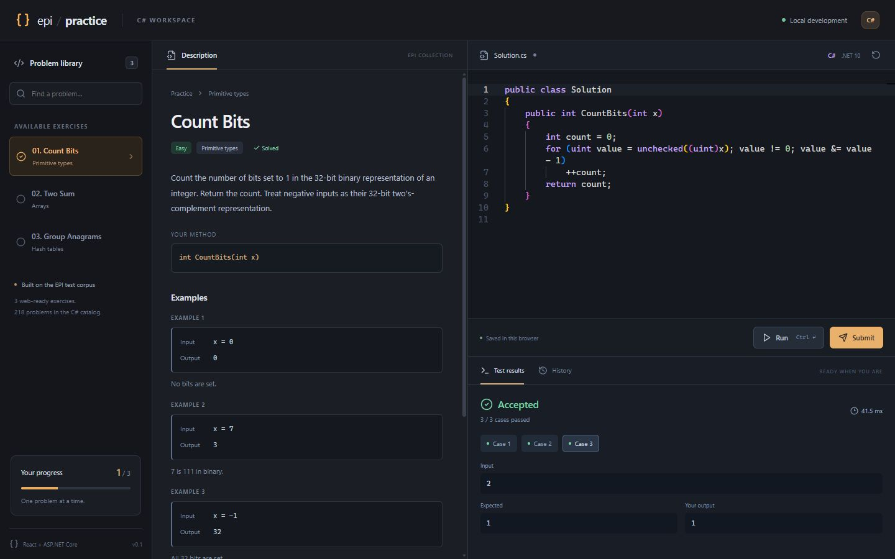

# EPI Practice website

A local React + TypeScript website with an ASP.NET Core API and a C# execution
worker. All **218 problems included in this repository** are available through
the website, using their real TSV test files. This is the repository's catalog,
not every exercise or variant in every edition of the EPI book.



## Start with the Visual Studio Play button

1. Open **`EPIJudge.Web.slnx`** from the repository root in Visual Studio 2026.
2. Set **EpiJudge.Web** as the startup project if it is not already selected.
3. Select the **Website** launch profile, then press **F5** or the green Play button.

The website opens directly at **`http://localhost:5178`** and stays at that URL.
ASP.NET Core starts Vite in the background and waits until React is ready before
it begins listening. Frontend requests and hot-reload WebSockets pass through
the C# server, so there is no SPA proxy landing page or browser redirect.

The main `EPIJudge.slnx` also includes the website. Both solutions provide a
shared **Website** launch configuration that starts the server; the server
starts the client automatically. Do not start a second Vite instance on the
same port.

Prerequisites are the **.NET 10 SDK**, **Node.js 24 LTS with npm**, and Visual
Studio's **ASP.NET and web development** workload. Node/npm build and develop
the frontend; all application APIs and judge execution use C#.

On Daniel's machine, Node is installed at
`C:\Dev\Tools\node-v24.19.0-win-x64` and added to the user PATH. The development
server launcher also checks the current user PATH, so it can find Node even if
Visual Studio was open when Node was installed. It launches Vite with Node
directly rather than relying on npm being available in Visual Studio's PATH.

The first project build restores .NET and npm dependencies. Subsequent builds
reuse them. The npm dependency versions are recorded in `package-lock.json`.

## Use the website

1. Select a problem from the library. Search by title or ID, or filter by topic.
2. Implement the method inside the supplied `Solution` class. Keep its name,
   parameters, and return type so the harness can call it.
3. Click **Run** (Ctrl+Enter) for the first three visible cases in that problem's TSV.
4. Click **Submit** (Ctrl+Shift+Enter) to check every row in the TSV.

Run results include the input, expected value, actual value, and any runtime
exception. Submit returns totals and a status without revealing hidden case
contents. Compiler diagnostics appear in the results panel.

Code, the latest 50 attempt summaries, and solved status are saved in this
browser's local storage. There are no accounts or shared database yet. Reset
restores the current problem's starter code after confirmation.

## Project layout

| Project | Purpose |
| --- | --- |
| `epijudge.client` | React, TypeScript, Vite, and the Monaco C# editor |
| `EpiJudge.Web` | ASP.NET Core endpoints, frontend startup, and same-origin development proxy |
| `EpiJudge.Runner` | Problem descriptions, TSV adapter, compilation, execution, comparison |
| `test_data` | Existing EPI test corpus |

`ProblemCatalog.cs` keeps the original three APIs compatible with saved code.
The other entries are embedded from `EpiJudge.Runner/catalog.json`. Regenerate
that file after editing descriptions or signatures in
`scripts/generate_web_catalog.py`:

```powershell
python scripts/generate_web_catalog.py
```

Each exercise includes a statement, C# starter, and examples drawn from its TSV.
New exercises are marked **Unrated**, rather than assigning invented difficulty
levels. These are practice stubs for you to solve, not prefilled solutions.

### C# contracts and grading

- Lists and arrays use `List<T>`; record-like values use value tuples.
- `using EpiJudge.TestFramework;` supplies `ListNode<T>`, `BinaryTreeNode<T>`,
  `PostingListNode`, and `GraphVertex`. Their members are documented in the
  exercise's constraints. Keep the namespace import in the starter.
- Several APIs return the normalized value used by the original test wrapper:
  for example, closest stars returns distances, and tree traversal exercises
  return values. Follow the displayed C# signature and description.
- In-place partitioning and Sudoku are checked after mutation. Shared-list,
  graph-copy, and posting-list exercises check object identity and links.
- Queue, stack, cache, and credit exercises expose multiple methods on
  `Solution`. `Initialize` resets the state for the next command sequence;
  operation results are checked against the recorded commands.
- Problems with multiple valid outputs have dedicated validators. Their visible
  expected output may be a property such as `true`, a shortest interval's length,
  or a tree's height, rather than the object your method returns.
- Randomized exercises draw 100,000 samples per batch and check legal values,
  frequencies, and (for uniform distributions) pairs and triples. Up to three
  batches allow for rare statistical failures. These checks are statistical,
  not a proof of randomness, and can take longer than ordinary exercises.
- Floating-point results use relative tolerance `1e-9` with an absolute floor of
  `1e-9`. Order is ignored only for exercises that permit it; sequence order
  remains significant inside permutations and word decompositions.

The web adapters are separate from the older console scaffold. A console stub
alone does not register a working web exercise.

## Terminal workflow

From the repository root:

```powershell
dotnet run --project EpiJudge.Web --launch-profile Website
```

Open `http://localhost:5178` if the terminal does not open a browser. To run the
two processes separately, use two terminals:

```powershell
# Terminal 1: API without automatically starting Vite
dotnet run --project EpiJudge.Web --launch-profile "API only"

# Terminal 2
cd epijudge.client
npm ci
npm run dev
```

Build the backend and type-check/build the frontend with:

```powershell
dotnet build EPIJudge.Web.slnx
cd epijudge.client
npm run build
```

With the API running, `scripts/Verify-Web.ps1` checks real accepted submissions,
wrong answers, compiler errors, runtime errors, timeouts, and hidden-case
redaction against the local API.
Add `-CheckFrontend` when running the Website profile to also check that React
and hot reload are served directly without a redirect.

### Catalog and adapter audit

From the repository root, run:

```powershell
dotnet build scripts/WebAudit/WebAudit.csproj --configuration Release --maxcpucount:1
dotnet scripts/WebAudit/bin/Release/net10.0/WebAudit.dll
```

This checks all catalog IDs and counts, deserializes every corpus argument,
round-trips the expected result types, exercises every custom adapter against
reference fixtures, rejects selected broken implementations, compiles all 218
real starters with their generated harnesses, and runs a regression through the
actual submission worker. The fixtures do not implement every ordinary problem;
this is an audit of catalog wiring and grading, not proof that every conceivable
incorrect solution will be rejected.

With Website running, the HTTP regression suite also checks real submissions
covering primitive values, tuples, mutable arrays, trees, graph copies, posting
lists, caches, randomness, and floating-point results:

```powershell
./scripts/Verify-Web.ps1 -BaseUrl http://localhost:5178 -CheckFrontend
```

The intentional infinite-loop check takes 60 seconds. Use `-SkipTimeout` for a
faster repeat after already checking process termination.

## Execution scope

This release is for **your own trusted code on your local machine**. It binds
to localhost, rejects remote API callers, and enables compilation only in the
Development environment. Each attempt compiles a temporary .NET project,
executes it as a separate process, and removes its temporary directory.

The runner allows one attempt at a time, limits compilation to 45 seconds,
limits execution to 60 seconds for the complete test run, caps captured output
at 16 million characters per output stream,
and kills timed-out process trees. These process controls are not an operating
system sandbox: submitted C# has your user's file and network permissions.
Public submissions require an isolated worker with resource and network
controls before this can be hosted for other people.

The repository's existing LICENSE applies to its test data and other material;
review those terms before publishing or distributing a hosted problem library.

## Troubleshooting

- **npm is not recognized:** reopen Visual Studio after installing Node; check
  `node --version` and `npm --version` in a new terminal.
- **Port 5173 is in use:** stop an old Vite process or previous debugging session.
- **The library cannot load:** check server output and confirm the API is
  listening on port 5178.
- **Compilation cannot start:** confirm the .NET 10 SDK is installed and the app
  is running inside this repository with `test_data` present.
- **F5 opens the console judge:** choose EpiJudge.Web as the startup project and
  select its Website launch profile.
- **An old SPA proxy page is still open:** stop the previous debugging session,
  rebuild, and press F5. The current Website profile opens the app directly on
  port 5178; the Microsoft SPA proxy package is no longer used.
- **React fails to start:** the server reports the failure in Visual Studio's
  output instead of serving a waiting page. Check whether another process is
  using port 5173. You can set `Frontend:NodePath` to an explicit Node executable
  or `Frontend:Port` to a different internal development port if needed.
